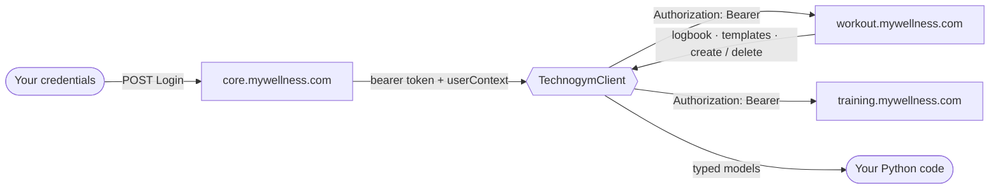

<div align="center">

# 🏃 unofficial-technogym-api

**A clean, typed Python client for your own Technogym / mywellness account.**

Authenticate as the account owner, read your workout history, and manage workouts — all from Python or the command line.

<br/>

[](https://www.python.org/)
[](#-license)
[](#)
[](https://www.python-httpx.org/)
[](#-disclaimer)

</div>

> [!WARNING]
> **Unofficial & unaffiliated.** Not connected to, endorsed by, or supported by Technogym S.p.A.
> Use it **only with your own account**, with your own credentials. Use at your own risk.

<div align="center">

[Features](#-features) · [Quick start](#-quick-start) · [Usage](#-usage) · [How it works](#-how-it-works) · [Endpoints](#-endpoint-status) · [Development](#-development)

</div>

---

## ✨ Features

| | Feature | Notes |
| :--: | :-- | :-- |
| 🔐 | **Owner authentication** | Email + password login; bearer token managed for you |
| 👤 | **Profile** | Read account identity straight from the login response |
| 📒 | **Workout logbook** | Your performed-workout history (machine sessions, calories, MOVE, duration) |
| 🗂️ | **Saved templates** | List saved workout templates between two dates |
| ✍️ | **Create & delete workouts** | Write operations, each with a `dry_run` preview before anything is sent |
| 🧰 | **Library + CLI** | Use it in code or from the terminal — same client underneath |
| 🔒 | **Secret-safe by default** | Passwords & tokens are never echoed, logged, or written to disk |
| 🧪 | **Offline tests** | `pytest` suite runs on synthetic fixtures — no account required |

<sub>**Reads are the default.** Write methods (`create_workout`, `delete_workout`) mutate your account and are opt-in.</sub>

---

## 🚀 Quick start

```bash
# 1. Install from a checkout
pip install -e .

# 2. Provide your own credentials
cp .env.example .env        # then edit TG_USERNAME / TG_PASSWORD

# 3. Go
technogym me
technogym workouts log --size 20
```

> Requires **Python 3.11+**. Credentials come from `.env`, environment variables, or a secure prompt — never from the command line.

---

## 📦 Usage

### Library

```python
from technogym_unofficial import TechnogymClient

with TechnogymClient(tz_olson="Europe/Istanbul") as tg:
    profile = tg.login("you@example.com", "your-password")
    print(profile.first_name, profile.id)

    # performed-workout history (the activity logbook)
    for e in tg.get_logbook(desired_size=50).entries:
        print(e.performed_on, e.title, e.equipment_name,
              f"{e.calories} kcal", f"{e.duration_seconds}s")

    # create a workout (write) — inspect the request first with dry_run
    print(tg.create_workout("My workout", dry_run=True))
    wid = tg.create_workout("My workout")
    tg.delete_workout(wid)
```

Credentials default to the `TG_USERNAME` / `TG_PASSWORD` environment variables,
so `tg.login()` can be called with no arguments.

### CLI

<details open>
<summary><b>Command reference</b></summary>

<br/>

| Command | What it does |
| :-- | :-- |
| `technogym me` | Show the account profile |
| `technogym auth status` | Check that login works |
| `technogym workouts log --size 20` | Performed-workout history (logbook) |
| `technogym workouts list --from 2026-10-01 --to 2026-10-31` | Saved workout templates in a date range |
| `technogym workouts create "My workout" --dry-run` | Preview the write without sending |
| `technogym workouts create "My workout"` | Actually create the workout |
| `technogym workouts delete U-<id>` | Delete a workout by id |

</details>

The password is read from the environment or a secure prompt and is **never**
echoed, logged, or written to disk.

---

## 🔍 How it works



<details>
<summary><b>Design notes</b></summary>

<br/>

- **Host** is `{service}.mywellness.com` (`core`, `workout`, `training`). The
  `--env` flag selects `-dev` / `-test` / `-beta` variants.
- Requests carry the app-identity headers `x-mwapps-appid`, `x-mwapps-client`,
  `x-mwapps-clientversion` and a daily `x-mwapps-pdate`. These must be exact —
  a wrong app id yields an empty `401` **before** the server checks credentials.
- The bearer token from login is attached as `Authorization: Bearer` on
  subsequent requests. Secrets are redacted from debug logs and exceptions.
- Reads are the default. The write methods (`create_workout`, `delete_workout`)
  mutate the account and each accepts `dry_run=True` to preview the request.

</details>

---

## 📡 Endpoint status

Every row below was confirmed with a real request/response against a personal
account (app `3.46.0`). See [`docs/endpoints.md`](docs/endpoints.md) for full
request/response details.

| Operation | Endpoint | Type | Status |
| :-- | :-- | :--: | :--: |
| Login | `POST core…/v2/enduser/authentication/Login` | read | ✅ live |
| Profile | `userContext` from the login response | read | ✅ live |
| Workout history (logbook) | `GET workout…/logbook` | read | ✅ live |
| Saved workout templates | `GET workout…/v2/enduser/workout/GetUserWorkouts` | read | ✅ live |
| Create workout | `PUT workout…/v2/enduser/workout` | write | ✅ live |
| Delete workout | `DELETE workout…/v2/enduser/workout` | write | ✅ live |

---

## 🛠️ Development

```bash
pip install -e ".[dev]"     # install with dev tools (pytest, respx, ruff)
pytest                      # offline tests, synthetic fixtures only
ruff check .                # lint
```

---

## 📄 License

Released under the **MIT License**.

<div align="center">
<sub>Personal project · not affiliated with Technogym S.p.A. · for use with your own account only</sub>
</div>
